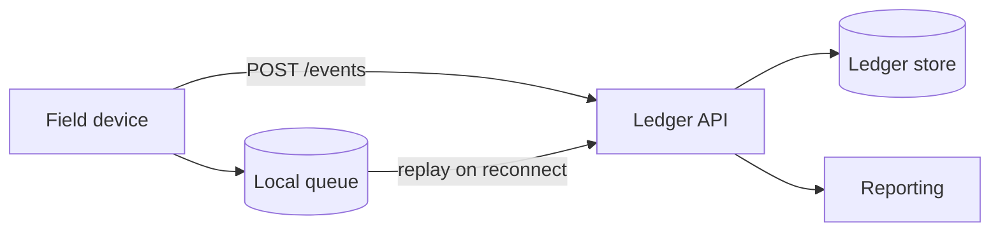
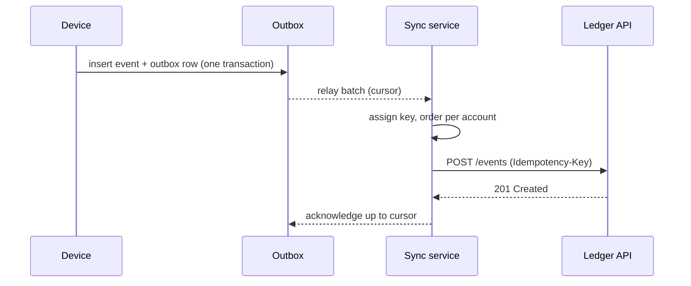

# Ledgerline sync service: architecture report

> [!NOTE]
> **Illustrative fixture.** This report describes a fictional service, Ledgerline,
> written to exercise the deliverable reader. Every name, figure and address in it
> is invented. Nothing here describes a real system.

Prepared by the platform working group for the design review of LAI-0000.
Version 2, revised after the first design review.

## 1. Summary

Ledgerline moves accounting events from field devices into a central ledger. Today
each device posts directly to the ledger API, retries on its own schedule, and
the ledger deduplicates what it can. The result is a system that is correct most
days and expensive to reason about on the others.

This report proposes a dedicated **sync service** between the devices and the
ledger. Devices write to a durable outbox; the service relays the outbox to the
ledger exactly once per event, in order per account. The change is additive: the
ledger API stays as it is, and devices that have not upgraded keep working.

The recommendation is to build the service in three increments over one and a
half quarters, with the outbox relay first because it removes the largest class
of incidents, and to start shadow mode in the smallest region.

### 1.1 What the reader should take away

- The duplicate-posting incidents share one cause: retries without an
  idempotency key that survives a device restart.
- An outbox with a relay fixes that cause without changing the ledger.
- Ordering per account is a requirement; global ordering is not.
- The cost is one new service, one new table per device database, and a
  migration that can be done device by device.

### 1.2 What this report does not cover

Reporting, reconciliation and the ledger's own storage are out of scope. They
are referenced where they constrain the design and are otherwise left alone.

## 2. Context

### 2.1 The system today

A field device records an event — a payment taken, a refund issued, a float
adjusted — and posts it to the ledger over HTTPS. The device keeps a local
SQLite database for offline work and replays anything unsent when it reconnects.



The replay is where the trouble starts. A device that crashes after the ledger
accepted an event, but before the device recorded the acceptance, replays it.
The ledger sees a second event with a new request id and books it twice.

### 2.2 Incidents in the last two quarters

Twelve incidents were filed against posting. Ten of them were duplicates, one
was a lost event during a storage migration, and one was an ordering problem
where a refund arrived before the payment it refunded.[^incidents]

| Quarter | Duplicates | Lost | Out of order | Hours to reconcile |
| --- | ---: | ---: | ---: | ---: |
| Q1 | 4 | 0 | 1 | 31 |
| Q2 | 6 | 1 | 0 | 52 |

### 2.3 Constraints

#### 2.3.1 Devices are offline for days

Some devices work in places with no signal for most of a week. Whatever we build
must tolerate a backlog of several thousand events arriving at once.

#### 2.3.2 The ledger API cannot change this year

The ledger team has a frozen interface until its own migration finishes. The
sync service must speak the existing `POST /events` contract.

#### 2.3.3 Devices upgrade slowly

A device takes up to ninety days to pick up a new build. Old and new devices
will coexist for at least one quarter.

## 3. Goals and non-goals

### 3.1 Goals

1. Every event recorded on a device is booked in the ledger **exactly once**.
2. Events for one account are booked **in the order they were recorded**.
3. A device that has been offline for a week catches up within ten minutes of
   reconnecting.
4. An operator can see, for any device, how far behind it is.

### 3.2 Non-goals

- Global ordering across accounts.
- Changing the ledger's storage or its API.
- Real-time reporting; reporting stays on its hourly batch.

## 4. Proposed design

### 4.1 Overview

The device writes each event to an **outbox** table in the same transaction that
records it. A small relay on the device ships outbox rows to the sync service.
The sync service assigns a durable idempotency key, orders events per account,
and posts them to the ledger.



### 4.2 The outbox table

The outbox lives in the device database beside the events it describes. It is
written in the same transaction, so an event cannot exist without its outbox row
and an outbox row cannot exist without its event.

```sql
CREATE TABLE outbox (
  seq          INTEGER PRIMARY KEY AUTOINCREMENT,
  event_id     TEXT    NOT NULL UNIQUE,
  account_id   TEXT    NOT NULL,
  recorded_at  INTEGER NOT NULL,
  payload      TEXT    NOT NULL,
  shipped_at   INTEGER
);

CREATE INDEX outbox_unshipped ON outbox (seq) WHERE shipped_at IS NULL;
```

The `event_id` is generated on the device when the event is recorded and never
changes. That is the property today's design lacks: the key survives a restart
because it is written to disk before anything is sent.

### 4.3 The relay

The relay reads unshipped rows in `seq` order, sends them in batches, and marks
them shipped only when the sync service acknowledges the batch. A crash between
send and acknowledge means the batch is sent again, and the sync service
recognises every event in it.

The relay is the largest piece of new device code, so it is reproduced in full
below for review.

```ts
/**
 * The device-side outbox relay (illustrative).
 *
 * Reads unshipped outbox rows in sequence order, sends them in batches, and
 * marks them shipped only after the sync service acknowledges the batch.
 */

export interface OutboxRow {
  readonly seq: number;
  readonly eventId: string;
  readonly accountId: string;
  readonly recordedAt: number;
  readonly payload: string;
}

export interface OutboxStore {
  unshipped(limit: number): Promise<readonly OutboxRow[]>;
  markShipped(upTo: number, at: number): Promise<void>;
  count(): Promise<number>;
}

export interface SyncClient {
  send(batch: readonly OutboxRow[]): Promise<SendResult>;
}

export type SendResult =
  | { readonly kind: 'acknowledged'; readonly upTo: number }
  | { readonly kind: 'retry'; readonly afterMs: number }
  | { readonly kind: 'rejected'; readonly seq: number; readonly reason: string };

export interface RelayOptions {
  readonly batchSize: number;
  readonly minBackoffMs: number;
  readonly maxBackoffMs: number;
  readonly now: () => number;
  readonly sleep: (ms: number) => Promise<void>;
  readonly log: (line: string) => void;
}

export const DEFAULT_OPTIONS: Omit<RelayOptions, 'now' | 'sleep' | 'log'> = {
  batchSize: 250,
  minBackoffMs: 500,
  maxBackoffMs: 60_000,
};

export interface RelayState {
  readonly shipped: number;
  readonly lastSeq: number | null;
  readonly attempts: number;
  readonly stopped: boolean;
  readonly lastError: string | null;
}

export function initialState(): RelayState {
  return { shipped: 0, lastSeq: null, attempts: 0, stopped: false, lastError: null };
}

/** Exponential backoff with full jitter, clamped to the configured range. */
export function backoff(attempt: number, min: number, max: number, random: () => number): number {
  const ceiling = Math.min(max, min * 2 ** Math.max(0, attempt - 1));
  // Full jitter, but never below the floor: a zero wait hammers a recovering service.
  return Math.max(min, Math.floor(random() * ceiling));
}

/** Rows must arrive strictly increasing; anything else is a store defect. */
export function assertOrdered(rows: readonly OutboxRow[]): void {
  for (let i = 1; i < rows.length; i++) {
    const before = rows[i - 1];
    const after = rows[i];
    if (before === undefined || after === undefined) continue;
    if (after.seq <= before.seq) {
      throw new Error(`outbox rows out of order: ${String(before.seq)} then ${String(after.seq)}`);
    }
  }
}

/** Group a batch by account, keeping each account's rows in sequence order. */
export function byAccount(rows: readonly OutboxRow[]): Map<string, OutboxRow[]> {
  const groups = new Map<string, OutboxRow[]>();
  for (const row of rows) {
    const list = groups.get(row.accountId);
    if (list === undefined) groups.set(row.accountId, [row]);
    else list.push(row);
  }
  return groups;
}

export class Relay {
  private state: RelayState = initialState();
  private running = false;

  constructor(
    private readonly store: OutboxStore,
    private readonly client: SyncClient,
    private readonly options: RelayOptions,
    private readonly random: () => number = Math.random,
  ) {}

  snapshot(): RelayState {
    return this.state;
  }

  stop(): void {
    this.running = false;
    this.state = { ...this.state, stopped: true };
  }

  /** Ship one batch. Returns the number of rows acknowledged. */
  async tick(): Promise<number> {
    const rows = await this.store.unshipped(this.options.batchSize);
    if (rows.length === 0) return 0;
    assertOrdered(rows);

    const result = await this.client.send(rows);
    switch (result.kind) {
      case 'acknowledged': {
        await this.store.markShipped(result.upTo, this.options.now());
        const acked = rows.filter((r) => r.seq <= result.upTo).length;
        this.state = {
          ...this.state,
          shipped: this.state.shipped + acked,
          lastSeq: result.upTo,
          attempts: 0,
          lastError: null,
        };
        return acked;
      }
      case 'retry': {
        this.state = { ...this.state, attempts: this.state.attempts + 1 };
        await this.options.sleep(result.afterMs);
        return 0;
      }
      case 'rejected': {
        // A rejected row is a payload the ledger will never accept. Stop and
        // say so: skipping it would break per-account ordering silently.
        this.state = {
          ...this.state,
          lastError: `seq ${String(result.seq)} rejected: ${result.reason}`,
        };
        this.stop();
        this.options.log(`relay stopped: ${this.state.lastError ?? ''}`);
        return 0;
      }
    }
  }

  /** Run until stopped, backing off on failure. */
  async run(): Promise<void> {
    this.running = true;
    while (this.running) {
      try {
        const acked = await this.tick();
        if (acked === 0 && !this.state.stopped) {
          await this.options.sleep(this.options.minBackoffMs);
        }
      } catch (error) {
        const message = error instanceof Error ? error.message : String(error);
        this.state = {
          ...this.state,
          attempts: this.state.attempts + 1,
          lastError: message,
        };
        const wait = backoff(
          this.state.attempts,
          this.options.minBackoffMs,
          this.options.maxBackoffMs,
          this.random,
        );
        this.options.log(`relay error, retrying in ${String(wait)}ms: ${message}`);
        await this.options.sleep(wait);
      }
    }
  }

  /** How far behind this device is, for the operator view. */
  async lag(): Promise<{ readonly pending: number; readonly lastSeq: number | null }> {
    return { pending: await this.store.count(), lastSeq: this.state.lastSeq };
  }
}
```

#### 4.3.1 Why the relay stops on a rejected row

Skipping a rejected row would let later rows for the same account through, and
the ledger would then hold a refund without its payment. Stopping is louder and
keeps the invariant. The operator view shows the stopped device and the reason.

#### 4.3.2 Batch size

A batch of 250 rows keeps a request under 256 KB for the largest payloads we
have seen. A device with a week's backlog of 6,000 events ships it in twenty-four
requests.

### 4.4 The sync service

#### 4.4.1 Idempotency

The service keys every event by `event_id`. A second delivery of the same
`event_id` is acknowledged without being posted again. The key is forwarded to
the ledger as the `Idempotency-Key` header, which the ledger already honours for
24 hours.

#### 4.4.2 Ordering per account

Events for one account are posted one at a time, in `recorded_at` order, with
the device sequence as a tie-breaker. Events for different accounts are posted
in parallel, up to a per-device limit.

```json
{
  "event_id": "evt_01HZX3K9Q4E0000000000000",
  "account_id": "acct_demo_0042",
  "recorded_at": 1767225600000,
  "kind": "payment",
  "amount_minor": 1250,
  "currency": "XTS"
}
```

#### 4.4.3 Storage

The service keeps a small table of delivered keys, pruned after 30 days, and a
cursor per device. Nothing else is stored; the events themselves pass through.

### 4.5 Data model

The service's two tables are described in 4.4.3. The device side adds only the
outbox table from 4.2; no other device schema changes.

## 5. Operations

### 5.1 Deployment

The service runs as two instances behind the existing internal load balancer.
It is stateless apart from its table, so either instance can serve any device.

```bash
# Roll out one instance at a time and wait for health.
for host in sync-a.example.test sync-b.example.test; do
  ./deploy --host "$host" --build "$BUILD_ID"
  until curl -fsS "https://$host/health" > /dev/null; do sleep 2; done
done
```

### 5.2 Observability

Each device reports its outbox depth on every relay batch. The service exposes
the same figure per device, so the operator view needs no device access.

> [!WARNING]
> A device whose depth grows for more than an hour while it is online is the
> signal to look at. Depth alone is not: an offline device is expected to grow.

### 5.3 Failure modes

| Failure | Effect | Recovery |
| --- | --- | --- |
| Device crashes mid-batch | batch resent | idempotency key absorbs it |
| Sync service down | outbox grows | relay backs off, ships on recovery |
| Ledger rejects a payload | relay stops for that device | operator fixes payload, restarts |
| Ledger slow | per-account queues lengthen | parallel accounts still progress |

## 6. Migration

### 6.1 Order of work

1. Ship the outbox table and relay to devices, writing but not sending.
2. Stand up the sync service in shadow mode, comparing against direct posts.
3. Switch devices to relay-only, one region at a time.

### 6.2 Coexistence

Old devices keep posting directly. Because the sync service forwards the
device's own `event_id` as the idempotency key, an old device and the service
cannot double-book the same event during the switch.

### 6.3 Region order

Shadow mode starts in the smallest region, where a defect reaches the fewest
devices, and moves to the largest last.

### 6.4 Rollback

Each region can return to direct posting by flag. The outbox keeps filling while
the flag is off, so a later switch back loses nothing.

## 7. Risks

### 7.1 Relay bugs on devices

Device code is slow to fix once shipped. Mitigation: the relay ships dark first,
writing the outbox for a full release before it sends anything.

### 7.2 Backlog spikes after outages

A regional outage reconnects hundreds of devices at once. Mitigation: the
service applies a per-device rate and the relay honours `retry` with a delay.

### 7.3 Key retention

The ledger honours an idempotency key for 24 hours. A device offline for longer
could replay an event the ledger has forgotten. Mitigation: the service keeps
delivered keys for 30 days and answers repeats itself (4.4.3).

> [!TIP]
> The load test in Appendix A reproduces this with 500 simulated devices.

## 8. Alternatives considered

### 8.1 Fix retries on the device only

Persisting the request id before sending would stop most duplicates. It does
not give ordering, and it spreads the fix across every device build. Rejected
as incomplete.

### 8.2 A message broker

A broker would give ordering and durability. It also adds a cluster to run for
a throughput we do not have: the whole fleet produces about forty events a
second at peak. Rejected as disproportionate.

### 8.3 Change the ledger

The ledger could deduplicate on a device key. Its interface is frozen this year
(see 2.3.2). Deferred, and compatible with this design if it happens later.

## 9. Open questions

1. Who owns the operator view — platform or the support tooling team?
2. Do we need per-device rate limits on day one, or can they follow?

## 10. Recommendation

Build the outbox and relay first, ship them dark, and stand the service up in
shadow mode. Decide on the switch per region once shadow mode has run clean for
two weeks in the smallest region.

## Appendix A. Load test

### A.1 Set-up

Five hundred simulated devices, each with a backlog of 6,000 events, reconnect
within one minute.

### A.2 Result

All backlogs drained in 7 minutes 40 seconds. No duplicates were booked, and
per-account order held for every account in the sample.

## Appendix B. Glossary

- **Outbox** — a table of events waiting to be sent, written in the same
  transaction as the events themselves.
- **Relay** — the device process that ships outbox rows to the sync service.
- **Idempotency key** — a value that makes a repeated request have the effect
  of a single one.

[^incidents]: Counts are from the illustrative incident log used for this
    fixture; they are not measurements of any real service.
