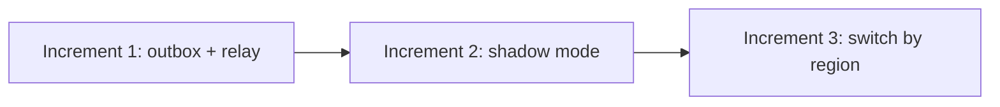

# Ledgerline sync programme: management summary

> [!NOTE]
> **Illustrative fixture.** The programme, figures and dates are invented to
> exercise the deliverable reader.

## Headline

> [!IMPORTANT]
> **Decision requested:** approve the outbox-and-relay design and fund the
> second increment. The first increment is on time and has already removed the
> most common cause of duplicate postings in testing.

## Where we are

| Measure | Target | Now | Trend |
| --- | ---: | ---: | --- |
| Duplicate postings per month | 0 | 1 | improving (was 4) |
| Hours spent reconciling per month | under 5 | 9 | improving (was 26) |
| Devices on the new relay | 100% | 18% | on plan |
| Acceptance cases passing | 95% | 76% | two high findings open |

## What has been delivered

- The outbox and relay are on 18% of devices, writing but not yet sending.
- The sync service runs in shadow mode in the smallest region.
- Acceptance testing of release 4.2 is complete, with two high findings.

## Decisions required

1. **Approve the design** as described in the architecture report, version 2.
2. **Fund increment 2**: two engineers for six weeks.
3. **Choose an owner** for the operator view: platform or support tooling.

## Risks

| Risk | Likelihood | Impact | Mitigation |
| --- | --- | --- | --- |
| Device upgrades slower than planned | Medium | Medium | Region-by-region switch; old devices keep working |
| Backlog spike after a regional outage | Low | High | Per-device rate limits in the service |
| Ledger interface changes mid-programme | Low | Medium | Interface frozen until year end |

## Recommendation

Approve the design and fund increment 2. Revisit at the end of shadow mode,
when the duplicate rate in the shadow region is known.

## Outstanding issues

- **F-01** — partial refunds on split payments book to one tender. Fix due
  before release.
- **F-02** — the operator view double-counts a re-sent batch. Fix in review.
- The operator view has no owner yet (decision 3 above).
